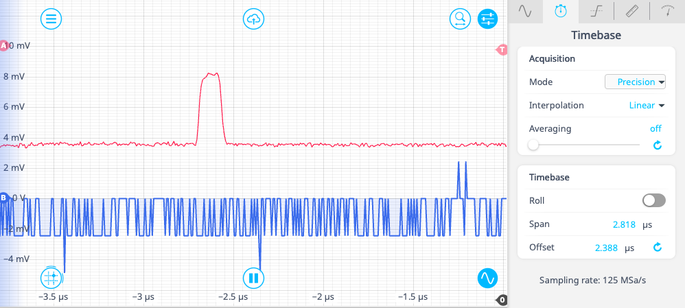
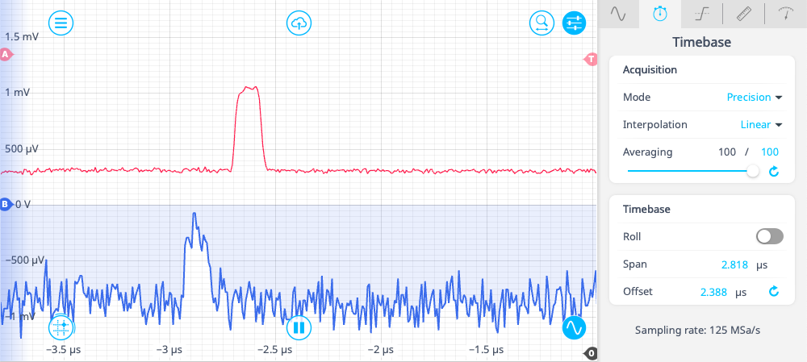

# Frame Averager (Interlaced)

This project implements a frame-based signal averager, also known as waveform recovery, for the Moku platform. A rising crossing on the trigger input starts a configurable delay, after which the instrument captures a frame of configurable length. Each captured frame is accumulated in on-chip memory, allowing frames from repeated trigger events to be averaged before the result is read out.

The design processes multiple samples per FPGA clock cycle. The number of input and output lanes are provided by the platform through `input_interlacing_factor` and `output_interlacing_factor`, so the same VHDL source can match different hardware data-path widths.

## Platform Specifications (Moku Compile 4.3.0)

The following parameters were tested with a frame length of 16,384 clock cycles for the supported platforms and slot configurations as of Moku Compile 4.3.0.

The frame size and accumulator width can be customized in [`vhdl/FrameAvg.vhd`](vhdl/FrameAvg.vhd):
* **Frame Length**: Modify `C_FRAME_SIZE`. When changing `C_FRAME_SIZE`, ensure the address bitwidth `C_ADDR_WIDTH` is also adjusted to satisfy `2^C_ADDR_WIDTH >= C_FRAME_SIZE`
* **Accumulator Bitwidth**: Modify `C_ACC_WIDTH` to accommodate the required dynamic range and prevent overflow.

| Platform | Slot Configuration | Clock Rate | Sampling Rate | Min Timing Resolution | Frame Duration (16,384 cycles) | Accumulator Width |
| :--- | :--- | :--- | :--- | :--- | :--- | :--- |
| **Moku:Go** | 2-slot mode | 31.25 MHz | 125 MSa/s | 8 ns | 524.288 µs | 30-bit |
| **Moku:Go** | 3-slot mode | 31.25 MHz | 62.5 MSa/s | 16 ns | 524.288 µs | 40-bit |
| **Moku:Lab** | 2-slot mode | 125 MHz | 500 MSa/s | 2 ns | 131.072 µs | 30-bit |
| **Moku:Lab** | 3-slot mode | 125 MHz | 250 MSa/s | 4 ns | 131.072 µs | 40-bit |
| **Moku:Pro** | 4-slot mode | 312.5 MHz | 1.25 GSa/s | 0.8 ns (800 ps) | 52.4288 µs | 35-bit |
| **Moku:Delta** | 3-slot mode | 312.5 MHz | 5 GSa/s | 0.2 ns (200 ps) | 52.4288 µs | 16-bit |
| **Moku:Delta** | 5-slot mode | 312.5 MHz | 1.25 GSa/s | 0.8 ns (800 ps) | 52.4288 µs | 16-bit |
| **Moku:Delta** | 8-slot mode | 312.5 MHz | 625 MSa/s | 1.6 ns | 52.4288 µs | 16-bit |

## Architecture

### Interlacing and Frame Capture

* **Trigger detection**: The detector searches the interlaced trigger lanes for the first rising zero crossing, from the previous clock's final lane through the current clock's lanes.
* **Trigger delay**: After detection, capture waits for the configured delay in clock cycles.
* **Frame accumulation**: Samples at the same frame address are added to the accumulator for each input lane.
* **Frame limit**: Capture pauses after the configured number of completed frames.

### Output Processing

The accumulated value is multiplied by the signed fixed-point scale factor. The product is converted to a signed 16-bit sample and saturated to the output range before being mapped to `OutputA`. `OutputB` provides a capture activity marker, while `OutputC` and `OutputD` are held at zero.

## Inputs and Outputs

| Port | Description |
| :--- | :--- |
| **Input A** | Interlaced signed 16-bit signal samples to accumulate. |
| **Input B** | Interlaced signed 16-bit trigger samples. A rising crossing from non-positive to positive starts a frame sequence. |
| **Output A** | Scaled and saturated accumulated frame data. |
| **Output B** | Capture activity marker: `0x3FFF` while the capture pipeline is active, otherwise zero. |
| **Output C** | Zero. |
| **Output D** | Zero. |

## Control Registers

The instrument is configured through the Custom Instrument control registers:

| Register | Name | Description |
| :--- | :--- | :--- |
| `Control(0)` | **Frame Delay** | Number of clock cycles to wait between trigger detection and frame capture. |
| `Control(1)` | **Scale Factor** | Signed 16-bit fixed-point scale applied to each accumulated value. The product is shifted by 16 fractional bits before output. |
| `Control(2)` | **Frame Limit** | Number of completed frames to accumulate before capture pauses. |
| `Control(3)` | **Pre-Leveling Bias** | Signed 16-bit DC bias subtracted from `InputA` samples upon input registration to correct input DC offset. |
| `Control(4)` | **Reset Command** | Set bit 0 to reset the frame state, frame counter, capture state, and re-initialize capture. |

## Data Path and Timing

The capture path is strictly pipelined across **6 clock cycles (Cycle 0 through Cycle 5)** to align incoming signal samples with the synchronous Block RAM read/write operations and to pipeline the digital signal processing, scaling, and saturation stages.

### Pipeline Block Diagram

### Cycle-by-Cycle Pipeline Progression

| Clock Cycle | Functional Blocks | Registers / Signals Updated | Operation & Timing Role |
| :---: | :---| :---| :---|
| **Cycle 0** | Top Ports, Trigger Detector, Control Unpacker | `InputA`, `InputB`, `trigger_found`, `trigger_offset` | Asynchronous input sampling and combinational rising-edge zero-crossing search across $M$ parallel lanes. |
| **Cycle 1** | Input Registers, Capture FSM | `input_a_reg`, `input_b_reg`, `memory_address_reg`, `state_reg` | Latching input samples, registering trigger lane offset, and issuing the initial read address ($0 \to 127$) to BRAM. |
| **Cycle 2** | Barrel Shifter, BRAM Read Output | `input_a_d2_reg`, `memory_read_data_reg`, `state_d1_reg` | Circularly shifting incoming lanes so the trigger lane aligns to lane index 0; Synchronous BRAM read data becomes available. |
| **Cycle 3** | Vector Adder, BRAM Writeback | `memory_read_data_d1_reg`, `accum_mem`, `state_d2_reg` | Read-modify-write summation: the previous accumulated value is added to the aligned input sample and written back to BRAM ($A_{\text{write}} = A_{\text{read}} - 2$). |
| **Cycle 4** | DSP Fixed-Point Multiplier | `scaled_sample_reg`, `state_d3_reg` | Multiplies 32-bit accumulated sum by 16-bit `scale_factor` ($Q31.0 \times Q0.16 \to Q32.16$). |
| **Cycle 5** | Saturation, Output Driving | `output_a_reg`, `output_active`, `OutputA`, `OutputB` | Clamps high/low overflows to `0x7FFF` / `0x8000`, extracts bits `[31:16]`, and streams the valid frame to `OutputA` and the corresponding activity marker to `OutputB`. |

1. **BRAM Read-Modify-Write**:
   Synchronous Block RAM reads have a 1-cycle latency, followed by the 32-bit addition and 1-cycle write latency. The writeback address `memory_address_d2_reg` is delayed by 2 cycles relative to `memory_address_reg`. During continuous frame streaming, $A_{\text{write}} = A_{\text{read}} - 2$, guaranteeing that read and write ports never access the same address on the same clock cycle ($A_{\text{read}} \neq A_{\text{write}}$ for all sequential addresses $0 \le t \le 127$).
2. **Trigger Re-align via Input Barrel Shifting**:
   When an analog trigger crossing occurs at non-zero lane index $k$ ($0 < k < M$), incoming samples are rotated left by $k$ so lane index 0 always corresponds directly to the trigger event. Thus, memory address 0, lane 0 consistently stores the first post-trigger sample across all capture events.
3. **Capture Activity Marker**:
   `OutputB` provides a clean, synchronous frame activity marker (`0x3FFF`). It is asserted concurrently with `output_active` (`state_d4_reg = CAPTURE or READ`) during the active frame window, cleanly framing the valid samples on `OutputA`.

## Output Amplitude Equation

For one frame address, let $x_f$ be the signed input sample from frame $f$, let $N$ be the number of captured frames, and let $G$ be the signed scale value stored in `Control(1)`. The accumulated value and output are:

$$
S = \sum_{f=1}^{N} x_f,
\qquad
y = \text{sat}_{16}\left(\frac{S \cdot G}{2^{16}}\right)
$$

When the input is constant at $x$, and `frame_limit` is $N$, the expression becomes:

$$
y = \text{sat}_{16}\left(\frac{N \cdot x \cdot G}{2^{16}}\right)
$$

Here, $\text{sat}_{16}(z)$ means signed 16-bit saturation:

$$
\text{sat}_{16}(z) =
\begin{cases}
32767, & z > 32767 \\
-32768, & z < -32768 \\
z, & \text{otherwise}
\end{cases}
$$

Therefore, this implementation accumulates the frames rather than directly dividing the accumulated result by `frame_limit`. To produce a conventional average, program `Control(1)` with approximately $G = 2^{16}/N$. The final result is saturated to the signed 16-bit range $[-32768, 32767]$.

Before saturation, the output-to-input ratio for a constant input is:

$$
\frac{y}{x} = \frac{N \cdot G}{65536}
$$

For example, if the input is $x = 1000$, the following settings produce the corresponding results:

| Frame limit $N$ | Stored scale $G$ | Calculation | Output $y$ | Output relative to input |
| :--- | :--- | :--- | :--- | :--- |
| `4` | `16384` | $4 \cdot 1000 \cdot 16384 / 65536$ | `1000` | $1 \times x$ |
| `4` | `32767` | $4 \cdot 1000 \cdot 32767 / 65536$ | Approximately `1999` | Approximately $2 \times x$ |
| `8` | `32767` | $8 \cdot 1000 \cdot 32767 / 65536$ | Approximately `3999` | Approximately $4 \times x$ |

This shows that increasing either $N$ or $G$ increases the output amplitude. Alternatively, $G$ can be chosen larger so the output signal is digitally amplified, reducing the impact of quantization noise on the recovered waveform. It is recommended to target an output amplitude of roughly $1/4$ to $1/2$ of the full output range: this avoids both quantization noise (too small an output) and saturation (too large an output), which can provide a good balance between quantization noise and saturation. The signal can then be scaled back to its correct physical value in post-processing by accounting for the frame limit $N$ and the scale value $G$ using:

$$
x = \frac{y \cdot 65536}{N \cdot G}
$$

### What Does the Scale Format Mean?

The scale register is a signed 16-bit integer, but the design treats it as a fixed-point fraction with 16 fractional bits. In simple terms, the stored number is divided by $2^{16}$, or $65536$, to obtain the real gain. Here, `G` is the stored scale value.

The term **16 fractional bits** means that the binary point is understood to be 16 places from the right. For example:

| Stored `Control(1)` value | Real gain | Meaning |
| :--- | :--- | :--- |
| `16384` | $0.25$ | Keep one quarter of the accumulated value. |
| `32767` | Approximately $0.5$ | Largest positive gain available in this signed 16-bit register. |

This is sometimes described as a Q-format number. A notation such as `Q?.16` means that there are 16 bits after the binary point; the exact integer range depends on the total register width.

## Signal-to-Noise Ratio (SNR) Improvement and Sub-LSB Resolution

Averaging repeated frames synchronously aligned to a trigger event improves the signal-to-noise ratio (SNR) proportionally to the square root of the number of averaged frames $N$:

$$
\text{SNR}_{\text{improvement}} = \sqrt{N}
$$

When random noise or dither spans multiple quantization levels, coherent accumulation enables resolving signals that are smaller than the single-sample resolution (LSB) of the ADC.

### Experimental Setup and Measurement

The measurements below demonstrate recovery of a weak $400\ \mu\text{V}$ pulse, which is smaller than the native single-sample resolution level of the ADC ($\approx 2\text{ mV}$).

The following control-register values were programmed for this experiment:

| Register | Name | Applied Value | Function |
| :--- | :--- | :--- | :--- |
| `Control(0)` | Frame Delay | `100` | 100 clock cycle delay after trigger detection |
| `Control(1)` | Scale Factor | `16384` | Fixed-point scale factor for output scaling |
| `Control(2)` | Frame Limit | `16384` | Accumulation target of 16,384 frames |
| `Control(3)` | Pre-Leveling Bias | `0` | No bias correction |
| `Control(4)` | Reset Command | `1` $\to$ `0` | Toggled from 1 to 0 to initialize and clear memory |

To prepare the hardware for capture, `Control(4)` was flipped from 1 to 0 to perform an initial reset, clearing the internal state machine, resetting the frame counter, and clearing the Block RAM accumulation memory. A post-trigger delay of 100 clock cycles was configured in `Control(0)` to align the capture window with the pulse waveform. `Control(2)` was set to `16384` to accumulate 16,384 consecutive frames before automatically pausing capture. `Control(1)` was programmed to `16384` ($2^{14}$) to scale the accumulated values into the signed 16-bit output range without clipping or saturation.

#### Before Averaging vs. After 16,384 Averagings

Before averaging, the raw input signal on Channel B (blue trace) toggles randomly between discrete ADC quantization levels ($\approx 2\text{ mV}$ steps), with the $400\ \mu\text{V}$ pulse completely submerged beneath the ADC resolution floor. The on-board FPGA frame averager on Channel A (red trace) accumulates 16,384 frames ($N = 16384$, $\sqrt{16384} = 128\times$ SNR improvement), cleanly extracting the $400\ \mu\text{V}$ pulse out of the quantization noise.

#### After 100 Averagings vs. After 16,384 Averagings

After 100 averagings using the oscilloscope's software averaging function ($N = 100$), shown on Channel B (blue trace), the pulse begins to emerge from the noise floor, but substantial residual noise and quantization fluctuations remain visible. After 16,384 averagings with the on-board FPGA averager ($N = 16384$), shown on Channel A (red trace), the noise floor is suppressed sufficiently to resolve the $400\ \mu\text{V}$ sub-LSB pulse with high fidelity and a flat, stable baseline.

## Limitations

* A trigger must be detected while the instrument is idle. Triggers received during the delay or capture states are ignored.
* Only one rising crossing is selected per interlaced clock group; the first crossing in lane order has priority.
* The accumulation memory can overflow if the accumulated sum exceeds its representable range.

### Output Timing Jitter Relative to Trigger Input (`InputB`)

`OutputA` and `OutputB` may exhibit a small timing jitter (within 1 clock cycle) when measured on an oscilloscope triggered by an asynchronous trigger signal on `InputB`. This occurs because the trigger detector identifies the intra-clock lane offset ($0 \le k < M$) of the trigger crossing and dynamically applies that offset to `InputA` via an input barrel shifter to align the trigger sample to lane 0 (the FPGA clock boundary).

This alignment is required because memory words are read out block-by-block, where the width of each memory block matches the interlacing factor ($M$). By re-aligning `InputA` to lane 0 on the clock boundary, incoming signal samples can be accumulated directly into Block RAM address-by-address without requiring complex cross-word stitching during memory storage and readout. Consequently, while the resulting output frame is strictly aligned to the internal clock grid, the output delay relative to the exact physical trigger crossing varies by the sub-clock position ($k$) of that crossing.

Importantly, this timing variation is purely a visual artifact when triggering externally and does not affect internal frame averaging accuracy; repeated frames are accumulated inside memory with exact sample alignment at address 0, lane 0. Because `OutputB` serves as the hardware output marker defining the valid signal window, triggering the oscilloscope on the rising edge of `OutputB` provides a clean, stable, and jitter-free readout of `OutputA`.

